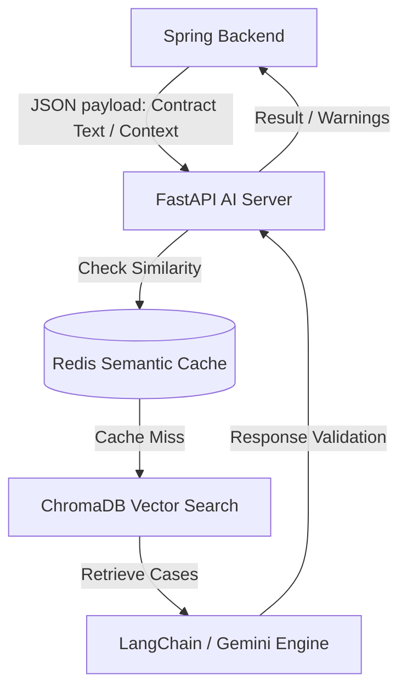

<div align="center">
  <h1>🏡 SSAFY Village (마을) - AI Service</h1>
  <p><b>RAG, 생성형 AI, 그리고 시맨틱 캐싱을 활용한 지능형 전자 계약 및 세무 리스크 챗봇 서비스</b></p>
</div>

---

## 🚀 프로젝트 개요 (Overview)

**Village (마을)** 프로젝트의 AI 서비스(마이크로서비스)는 사용자의 차용증 및 계약서를 분석하여 **독소조항과 세금 리스크를 사전에 탐지**하고, 자연어와 채팅 내역을 기반으로 **법적으로 유효한 특약사항을 자동 생성**해 주는 지능형 엔진입니다. 

빠른 응답 속도와 정확도를 보장하기 위해 사전 학습된 법률/판례 데이터를 기반으로 한 **RAG (Retrieval-Augmented Generation) 파이프라인**을 구축하였습니다.

---

## 🛠 기술 스택 (Tech Stack)

### Language & Framework


### AI & NLP DB


---

## ✨ 핵심 성과 및 주요 기능 (Core Features)

### 1. 🔍 RAG 기반 차용증 독소조항 및 세금 리스크 분석
- **Vector Search (ChromaDB)**: 수백 건 이상의 법령/판례 데이터를 사전에 임베딩(`BAAI/bge-m3`)하여, **90%+ 이상의 높은 Hit Rate**를 자랑하는 고정밀 검색기능 구현.
- **다중 리스크 판단 레이어**: 계약서 원문 분석 후 `SAFE`, `TAX_RISK_ONLY`, `LEGAL_VIOLATION`, `BOTH` 로 나누어 Spring 서버(서명 버튼 제어)에 전달하여 안전한 계약 환경 보장.

### 2. 📝 의도와 문맥을 반영한 조항 자동 생성 API
- **자연어 기반 조항 변환**: (예: "돈 안 갚으면 차 뺏을 거야" ➔ "조항: 차량 양도담보 설정")
- **채팅 기반 조항 도출 (MongoDB 연동)**: 채권자와 채무자 간 채팅 대화 내역(`chat_messages`)을 이해하여 합의된 특약 조건을 법적 용어로 자동 생성 (`/v1/clauses/from-chat`).

### 3. 🛡️ 2-Layer 방어(Input Validation) 및 안정성
- **Pre-filtering & LLM System Prompts**: 이상 탐지(Abnormal/malicious inputs) 차단 체계 구현 완료, 부정확하거나 주제를 벗어난 질문에 대한 응답을 Reject.
- **Multimodal OCR 적용**: 계약서 내 정보를 높은 해상도로 텍스트화하여 RAG 엔진으로 전달.

### 4. ⚡ Redis Semantic Caching & 성능 엔지니어링 (Locust Test)
- **응답 속도 획기적 개선**: LLM에 반복적인 질문이 들어올 때 API 요금 부과 및 지연 시간을 최소화하기 위해 **Redis 기반 시맨틱 캐싱** 적용.
- **Locust Performance Testing**: 50 Concurrent Users 동시 접속 상황에서도 안정적으로 응답하는 것을 내구성 테스트를 통해 무결성 입증 완료.

---

## 🏛 아키텍처 및 데이터 흐름 (Architecture & Data Flow)



---

## 📦 인프라 및 배포 가이드 (Deployment Guide)

본 프로젝트는 Docker를 통해 배포되며 `ai_service` 디렉토리 내 `Dockerfile`을 이용해 빌드합니다. 관련 설정 및 주의점은 다음과 같습니다.

### 1. 메모리 격리 (OOM 방지)
- AI 서비스가 로컬 모델(`bge-m3`, 약 2.2GB)을 로드하므로 총 5-6GB 메모리 점유가 예상됩니다.
- Spring Boot 애플리케이션과 같은 인스턴스에 있다면 Docker 컨테이너 실행 시 `--memory="8g"` 등으로 제한 설정을 권장합니다.

### 2. 볼륨 마운트 (Persistent Volume)
- 벡터 인덱스는 `./chroma_db`(SQLite & Indices 형태)에 저장됩니다.
- 컨테이너가 재시작되어도 유실되지 않도록 **반드시 외부 스토리지(Volume)에 매핑해야 합니다.**

### 3. 주요 환경 변수 (`.env`)
```env
GMS_KEY=your_gemini_api_key
INTERNAL_API_KEY=your_internal_secret_key
API_V1_STR=/internal/v1
CHROMA_DB_DIR=./chroma_db
```

---

## 📚 API 문서 (API Specification)

본 레포지토리에 포함된 세부 API 스펙 및 엔드포인트는 `ai_service/api_spec.md` 파일에서 확인하실 수 있습니다.

**[주요 Endpoints]**
- `POST /internal/v1/analyze`: 차용증 독소조항 및 세금 분석
- `POST /internal/v1/clauses/generate`: 자연어 기반 특약사항 생성
- `POST /internal/v1/clauses/from-chat`: 채팅 내역 기반 특약사항 생성
- `POST /internal/v1/chat`: 챗봇 Q&A 엔진

---
<div align="center">
  <sub>🔥 <b>Designed and developed for high performance and secure contract management.</b> 🔥</sub>
</div>
