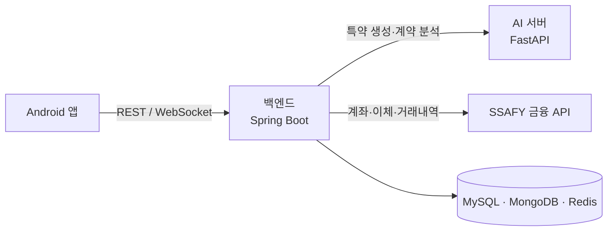

# Billage

지인 사이의 돈거래를 계약으로 남기고, 상환일마다 자동이체까지 처리하는 P2P 대차 서비스입니다.

- 기간: 2026.02 ~ 2026.03 (7주), SSAFY 공통 프로젝트
- 인원: 6명 (백엔드, 프론트엔드, AI)

## 무엇을 하나

가족이나 친구에게 돈을 빌려줄 때는 보통 말로만 약속합니다. 기록이 없으니 금액이나 상환일을 두고 다툼이 생기고, 갚는 사람은 날짜를 잊고, 받는 사람은 먼저 말을 꺼내기 어렵습니다.

1. 두 사람이 금액, 이자율, 상환 방식을 정해 계약서를 만든다
2. 채팅으로 특약을 협상하고, AI가 원하는 내용을 특약 문구로 바꿔 준다
3. 양쪽이 서명하면 차용증 PDF를 받는다
4. 상환일마다 채무자 계좌에서 채권자 계좌로 자동이체된다

## 저장소 구성

| 폴더 | 내용 | 기술 |
|---|---|---|
| [`be/`](be/) | 백엔드 API, 자동이체 스케줄러 | Java 21, Spring Boot 3.5, MySQL, MongoDB, Redis |
| [`FE/`](FE/) | Android 앱 | Kotlin, Jetpack Compose |
| [`AI/`](AI/) | 특약 생성, 계약 분석 | Python, FastAPI, LangChain, Gemini, ChromaDB |
| [`exec/`](exec/) | 빌드·배포 가이드, DB 덤프, 시연 계획 | |

배포는 Docker와 Jenkins로 했습니다.

## 백엔드 문서

| 문서 | 내용 |
|---|---|
| [백엔드 README](be/README.md) | 시스템 구성, 패키지 구조, 실행 방법, 테스트 |
| [자동이체](be/docs/auto-transfer.md) | 이체 순서, 은행 응답 분류, 결과 불명 대조 |
| [계약과 상환 회차](be/docs/contract.md) | 계약 생성 검증, 회차 계산, 특약, 차용증 |
| [데이터 모델](be/docs/erd.md) | 계약·상환 테이블 관계 |
| [설계 결정 기록](be/docs/adr/README.md) | 락 대신 조건부 UPDATE, 트랜잭션 분리, 재시도하지 않는 이유 등 |
| [트러블슈팅](be/docs/troubleshooting.md) | 직접 겪고 고친 문제들 |
| [운영 런북](be/docs/runbook.md) | 결과가 확정되지 않은 이체를 확인하는 절차 |

AI 서버 문서는 [AI/README.md](AI/README.md)에 있습니다.

자세한 경위는 [설계 결정 기록](be/docs/adr/README.md)과 [트러블슈팅](be/docs/troubleshooting.md)에 있습니다.
