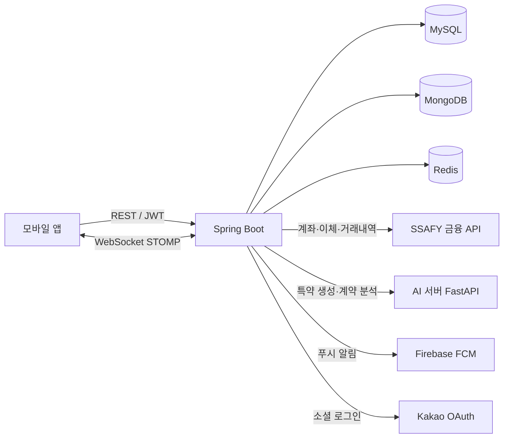
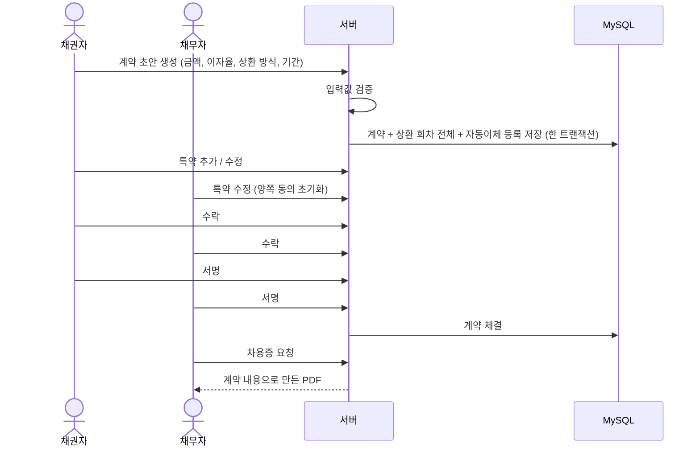

# Billage Backend

지인 사이의 돈거래를 계약으로 남기고, 상환까지 관리하는 P2P 대차 서비스의 백엔드입니다.

- 기간: 2026.02 ~ 2026.03 (7주), SSAFY 공통 프로젝트
- 인원: 6명 (백엔드, 프론트엔드, AI)

## 배경

가족이나 친구에게 돈을 빌려줄 때는 보통 말로만 약속합니다. 기록이 없으니 금액이나 상환일을 두고 다툼이 생기고, 큰 금액은 증여로 오해받아 세금 문제가 생기기도 합니다.

Billage는 이 과정을 서비스 안에서 처리합니다.

1. 두 사람이 금액, 이자율, 상환 방식을 정해 계약서를 만든다
2. 특약을 협상하고 양쪽이 서명한다
3. 서명된 계약으로 차용증 PDF를 받는다
4. 상환일마다 채무자 계좌에서 채권자 계좌로 자동이체된다

## 시스템 구성



| 저장소 | 용도 |
|---|---|
| MySQL | 회원, 계좌, 계약, 상환 회차 등 거래 데이터 |
| MongoDB | 계약 협상 채팅 메시지 |
| Redis | 리프레시 토큰 |

SSAFY 금융 API는 SSAFY가 교육용으로 제공하는 가상 금융망입니다. 실제 돈은 오가지 않지만, 계좌 개설·입금·계좌이체·거래내역 조회를 HTTP로 제공합니다.

## 기술 스택

- Java 21, Spring Boot 3.5, Spring Data JPA, QueryDSL, Spring Security
- MySQL 8, MongoDB 7, Redis 7
- WebSocket(STOMP), Firebase Admin(FCM)
- Thymeleaf + Flying Saucer (차용증 HTML → PDF)
- JUnit 5, Mockito, WireMock
- Docker, Jenkins

## 패키지 구조

레이어드 아키텍처를 도메인별 패키지로 나눴습니다. 도메인 안은 `controller / service / repository / entity / dto`로 나뉩니다.

```
com.ssafy.a305.be
├── domain
│   ├── auth          카카오 로그인, JWT 발급·재발급
│   ├── user          회원, 프로필, 약관 동의
│   ├── bank          계좌 개설·조회, 입금, 거래내역 (SSAFY 금융 API 연동)
│   ├── account       계좌 엔티티
│   ├── contract      계약 생성, 특약, 협상, 서명, 차용증 PDF, AI 특약
│   ├── document      서명·문서 엔티티
│   ├── repayment     상환 회차, 자동이체, 수동 상환, 이체 결과 대조
│   ├── notification  FCM 토큰, 상환 알림, 연체 전환
│   ├── chat          계약 협상 채팅 (MongoDB)
│   ├── tax           세금 계산 엔티티
│   └── enums
└── global
    ├── config        Security, WebSocket, Firebase, Swagger, QueryDSL
    ├── exception     공통 예외와 에러 코드
    └── external      SSAFY 이체 API 클라이언트
```

## 주요 흐름

### 계약에서 차용증까지



상환 회차 계산 규칙은 [docs/contract.md](docs/contract.md)에 있습니다.

### 자동이체

매일 10시, 14시, 18시에 기한이 된 미납 회차를 이체합니다. 이체 API는 DB 트랜잭션 밖에서 호출하고, 결과를 알 수 없는 이체는 다시 보내지 않고 거래내역과 대조해 확정합니다.

자세한 내용은 [docs/auto-transfer.md](docs/auto-transfer.md)에 있습니다.

### 스케줄러

| 시각 | 작업 |
|---|---|
| 09:00 | 상환일 알림 |
| 09:30 | 기한이 지난 미납 회차를 연체로 전환 |
| 10:00, 14:00, 18:00 | 결과 미확정 이체 대조 → 자동이체 |

## 실행

### 준비

- JDK 21
- Docker (MySQL, MongoDB, Redis)

```bash
docker compose up -d db mongodb redis
./gradlew bootRun
```

API 문서는 실행 후 `/swagger-ui.html`에서 볼 수 있습니다.

### 환경 변수

값은 저장소에 넣지 않습니다.

| 구분 | 변수 |
|---|---|
| DB | `SPRING_DATASOURCE_URL`, `SPRING_DATASOURCE_USERNAME`, `SPRING_DATASOURCE_PASSWORD` |
| Redis | `SPRING_DATA_REDIS_HOST`, `SPRING_DATA_REDIS_PORT`, `SPRING_DATA_REDIS_PASSWORD` |
| MongoDB | `SPRING_DATA_MONGODB_URI` |
| JWT | `JWT_ISSUER`, `JWT_SECRET`, `JWT_ACCESS_TOKEN_EXPIRATION_SECONDS`, `JWT_REFRESH_TOKEN_EXPIRATION_SECONDS` |
| Kakao | `KAKAO_CLIENT_ID`, `KAKAO_CLIENT_SECRET` |
| SSAFY 금융 API | `SSAFY_API_BASE_URL`, `SSAFY_API_KEY` |
| AI 서버 | `AI_SERVER_URL`, `AI_INTERNAL_API_KEY` |
| 운영 | `ALERT_WEBHOOK_URL` (비우면 로그만 남김), `OPS_API_KEY` (비우면 운영자 API 전부 거절) |

### DB 변경

`ddl-auto: update`는 기존 테이블에 인덱스나 제약을 추가하지 않습니다. 운영 DB에 반영할 변경은 `src/main/resources/db/manual/`에 SQL로 따로 둡니다.

## 테스트

```bash
./gradlew test
```

`BeApplicationTests`와 `AuthServiceRedisIntegrationTest`는 MySQL, Redis가 떠 있어야 통과합니다.
`RepaymentScheduleConcurrencyTest`는 Docker로 MySQL 컨테이너를 띄우며, Docker가 없으면 건너뜁니다.

| 대상 | 방식 |
|---|---|
| 자동이체, 수동 상환, 이체 결과 대조 | 단위 테스트 (Mockito) |
| 이체 API 응답 분류 | WireMock 가짜 은행 서버로 타임아웃·연결 끊김·5xx 재현 |
| 은행 장애 → 대조까지 시나리오 | WireMock + 실제 이체·조회 클라이언트 |
| 상환 회차 계산 | 단위 테스트 |
| 회차 상태 동시 변경 (선점, 수동 완료, 연체 전환, 납부 확정) | Testcontainers MySQL 8에서 스레드 10개로 동시 요청, 30회 반복 |
| 자동 확정 이벤트 유니크 인덱스 | `db/manual` SQL을 컨테이너에 그대로 실행해 확인 |

동시성은 테스트 컨테이너에서 검증했고, 운영 규모의 부하는 재현하지 않았습니다.

## 문서

| 문서 | 내용 |
|---|---|
| [데이터 모델](docs/erd.md) | 계약·상환 테이블 관계, 회차 상태, 이력 테이블 |
| [계약과 상환 회차](docs/contract.md) | 계약 생성 검증, 회차 계산, 특약, 차용증 |
| [자동이체](docs/auto-transfer.md) | 이체 순서, 은행 응답 분류, 결과 불명 대조 |
| [설계 결정 기록](docs/adr/README.md) | 락 대신 조건부 UPDATE, 트랜잭션 분리, 재시도하지 않는 이유 등 6건 |
| [트러블슈팅](docs/troubleshooting.md) | 상환 일정 단위 버그, 은행 비정상 응답, 상태 덮어쓰기 등 |
| [운영 런북](docs/runbook.md) | 결과가 확정되지 않은 이체를 운영자가 확인하는 절차 |
