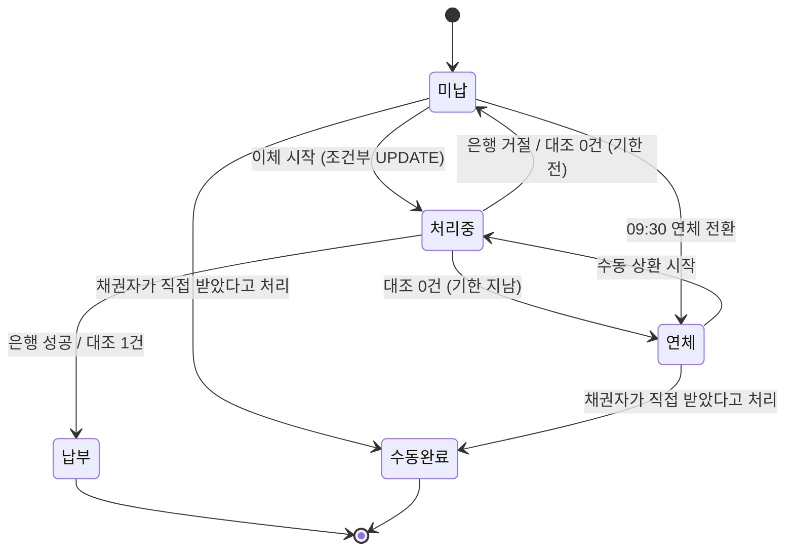
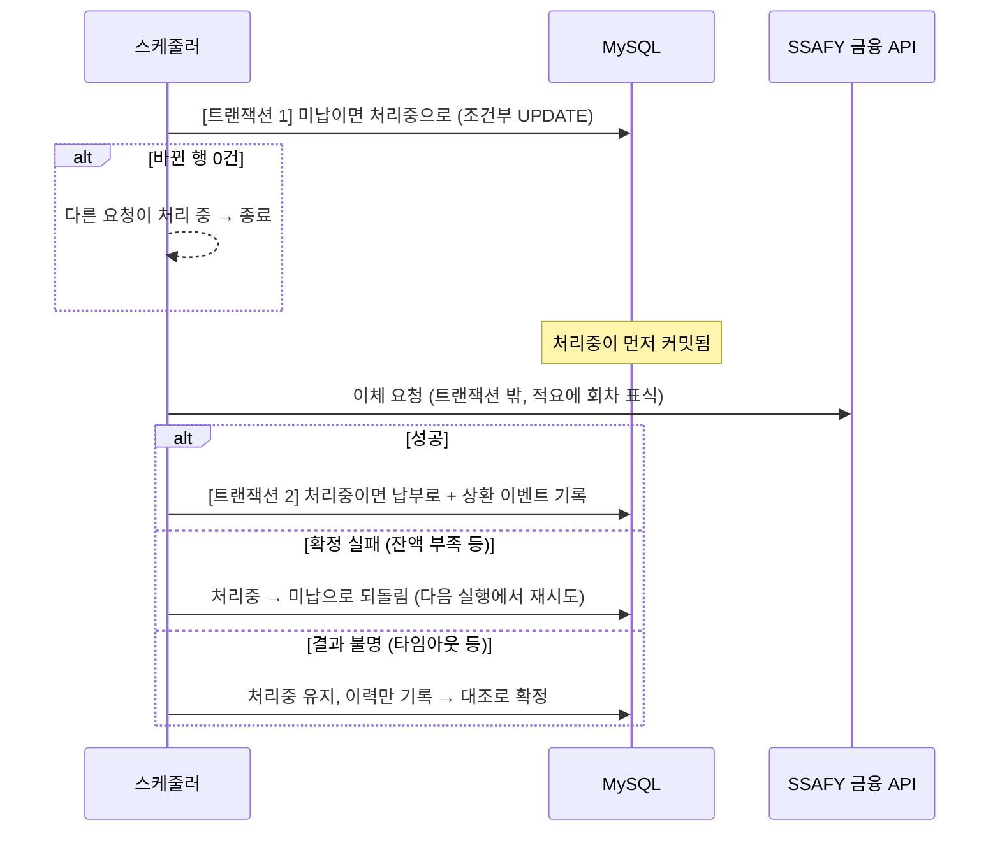

# 자동이체

상환일에 채무자 계좌에서 채권자 계좌로 회차 금액을 이체하는 기능입니다. 돈이 실제로 움직이기 때문에 **한 회차가 두 번 출금되지 않는 것**을 가장 먼저 지키도록 만들었습니다.

## 언제, 무엇을 이체하나

- 매일 10시, 14시, 18시에 실행합니다.
- 대상은 납부 기한이 오늘 이하이고 상태가 미납인 회차입니다. 계약은 체결 이후 상태여야 합니다.
- 기한 다음 날 09:30에 미납 회차는 연체로 바뀌어 대상에서 빠집니다. 그래서 평소에는 기한 당일 회차만 잡힙니다. 조건을 `=`가 아닌 `<=`로 둔 것은, 서버가 내려가 있었거나 연체 전환이 돌지 않은 날에도 놓친 회차를 다시 잡기 위해서입니다.
- 한 건이 실패해도 다음 건은 계속 처리합니다.

## 회차 상태

모든 상태 변경은 "지금 상태가 X일 때만 Y로 바꾼다"는 조건부 UPDATE로 합니다. 바뀐 행이 1건인 요청만 다음 단계로 갑니다. 자동이체, 수동 상환, 채권자 수동 완료, 연체 전환이 같은 회차를 동시에 건드려도 하나만 이깁니다. 진 쪽은 아무것도 하지 않고 끝납니다.

## 한 건을 처리하는 순서

### 왜 트랜잭션을 나눴나

이체 API를 트랜잭션 안에서 부르면, 송금은 됐는데 그 뒤 DB 오류로 기록만 롤백될 수 있습니다. 그러면 회차가 미납으로 돌아가 다음 실행에서 다시 출금됩니다.

처리중을 먼저 커밋해 두면, 이체 뒤에 무슨 일이 생겨도 회차는 처리중으로 남습니다. 처리중인 회차는 자동이체 대상이 아니므로 다시 출금되지 않습니다. 외부 응답을 기다리는 동안 DB 커넥션과 행 잠금을 잡고 있지 않는 것도 장점입니다.

## 은행 응답 분류

은행이 **처리하지 않은 것이 확실할 때만** 실패로 봅니다. 나머지는 돈이 나갔을 수 있으므로 결과 불명입니다.

| 응답 | 분류 | 이유 |
|---|---|---|
| 성공 코드 | 성공 | |
| 문서화된 거절 코드 (잔액 부족, 계좌 오류, 한도 초과 등) | 확정 실패 | 은행이 거절했다고 명시 |
| HTTP 4xx | 확정 실패 | 요청이 받아들여지지 않음 |
| 연결 거부, 호스트 없음 | 확정 실패 | 요청이 은행에 닿지 않음 |
| 응답 타임아웃, 연결 끊김, 깨진 응답 | 결과 불명 | 요청은 닿았고 답만 못 받음 |
| HTTP 5xx | 결과 불명 | 은행 내부에서 어디까지 처리됐는지 모름 |
| 모르는 응답 코드, 본문 없음 | 결과 불명 | 실패로 단정하면 재출금 위험 |

연결 타임아웃은 원래 요청이 닿기 전이지만, 예외 종류로 응답 타임아웃과 구분하기 어려워 결과 불명으로 둡니다.

타임아웃은 연결 3초, 응답 10초입니다. 응답 대기는 아래 대조 대기(10분)보다 반드시 짧아야 합니다. 그렇지 않으면 아직 응답을 기다리는 이체를 대조가 "안 나갔다"고 판정할 수 있습니다.

클라이언트는 스스로 재시도하지 않습니다. SSAFY 금융 API가 같은 요청을 중복으로 걸러준다는 보장이 없어서, 재시도가 곧 이중 출금일 수 있기 때문입니다.

## 결과 불명 대조

매 자동이체 실행을 시작할 때, 처리중으로 10분 넘게 남은 회차를 먼저 확인합니다.

1. 이체할 때 적요에 `BL{회차번호}`를 넣어 둡니다.
2. 채무자 계좌의 거래내역에서 이 표식과 금액이 둘 다 맞는 거래를 찾습니다. `BL12`가 `BL123`에 걸리지 않도록 표식 뒤에 숫자가 이어지면 다른 회차로 봅니다.
3. 찾은 건수로 판정합니다.

| 결과 | 처리 |
|---|---|
| 1건 | 납부로 확정 |
| 0건 | 출금되지 않음. 기한 전이면 미납, 지났으면 연체로 되돌림 |
| 2건 이상 | 자동 판정하지 않음. 처리중 유지, 사람이 확인 |
| 조회 실패 | 자동 판정하지 않음. 처리중 유지, 다음 실행에서 다시 대조 |

2건 이상이면 같은 금액의 다른 이체인지 중복 출금인지 시스템이 구분할 수 없습니다. 이럴 때 하나를 골라 확정하면 오류가 드러나지 않고 남기 때문에 사람에게 넘깁니다.

조회 API에도 타임아웃(연결 3초, 응답 5초)을 걸었습니다. 대조가 은행 응답을 무한정 기다리면 그 뒤의 자동이체가 시작되지 못합니다.

## 사람이 확인하는 방법

| | 내용 |
|---|---|
| 이력 | 회차 상태가 바뀔 때마다 이전 상태, 다음 상태, 사유, 처리자, 상세를 남깁니다. 결과 불명이면 오류 종류도 남습니다. |
| 지표 | 이체 결과별 건수, 대조 결과별 건수, 미해결 회차 수 (Micrometer, `/actuator/metrics`) |
| 알림 | 결과 불명이나 미해결이 생기면 웹훅으로 알립니다. `ALERT_WEBHOOK_URL`이 없으면 로그만 남깁니다. |
| 운영자 API | `GET /api/v1/ops/transfers/unresolved` 미해결 목록 `POST /api/v1/ops/transfers/{scheduleSeq}/review` 출금 여부와 메모로 확정 `X-Ops-API-Key` 헤더 필요 |

## 마지막 방어선

상환 이벤트 테이블에 "자동이체 확정"인 행은 회차당 하나만 들어가도록 유니크 인덱스를 둡니다. 조건부 UPDATE가 뚫리는 버그가 생겨도 같은 회차의 확정 기록이 두 번 남지 않습니다. 기존 테이블에 걸어야 해서 `src/main/resources/db/manual/`의 SQL로 따로 적용합니다.

## 한계

- DB 동시성은 Mock 기반 단위 테스트로만 검증했고, 실제 MySQL에서 경합을 재현하지 않았습니다.
- 결과 불명 판정은 "10분이면 거래내역에 반영된다"는 가정에 기대고 있습니다. 반영이 늦는 금융망이라면 대기 시간을 늘려야 합니다.
- 실제 운영 환경에서 알림이나 운영자 확인을 사용해 본 적은 없습니다.
