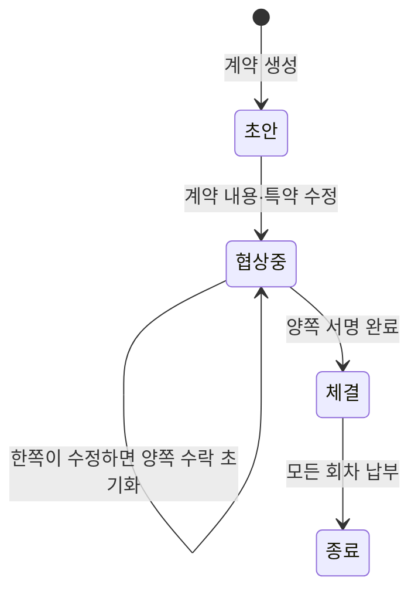

# 계약과 상환 회차

## 계약 상태

앱에서는 양쪽이 조건을 수락한 뒤 서명 단계로 넘어갑니다. 서명은 생체 인증을 거친 서명 이미지와 계약 내용의 해시(SHA-256)를 함께 저장합니다.

## 계약 생성

채권자나 채무자 중 한 명이 금액, 이자율, 상환 방식, 회차 수, 시작일, 종료일, 상환일을 보내면 초안이 만들어집니다. 아래 세 가지를 **한 트랜잭션**에서 처리합니다.

1. 입력값 검증
2. 상환 회차 전체 생성
3. 양쪽 주 계좌로 자동이체 등록

계좌가 없으면 계약 생성 자체를 롤백합니다. 계약은 있는데 자동이체가 없으면 상환일에 아무 일도 일어나지 않는 계약이 되기 때문입니다.

### 검증 규칙

| 규칙 | 이유 |
|---|---|
| 생성자는 채권자나 채무자 본인이어야 함 | 제3자가 남의 계약을 만들지 못하게 |
| 채권자와 채무자가 같으면 안 됨 | 자기 자신과의 계약 방지 |
| 종료일은 시작일보다 뒤 | |
| 회차 수는 1 이상 | |
| 계약 기간이 상환 주기 한 번 이상 | 예: 분기 상환인데 기간이 2개월이면 회차가 생길 수 없음 |
| 상환일은 1~31 | |
| 양쪽 모두 활성 회원 | |

## 상환 회차 계산

### 상환 방식

| 방식 | 주기 | 회차 구성 |
|---|---|---|
| 매월 / 분기 / 반기 / 연 | 1 / 3 / 6 / 12개월 | 원금 분할 + 남은 원금에 대한 이자 |
| 일시상환 (이자 있음) | 매월 | 매월 이자만, 마지막 회차에 원금 |
| 일시상환 (무이자) | - | 종료일에 원금 1회 |

회차 수는 "몇 번 내는지"입니다. 개월 수가 아닙니다. 예를 들어 12개월 분기 상환이면 회차 수는 4입니다. 날짜는 `시작일 + 회차 × 주기 개월`로 계산합니다.

### 금액

- 모든 금액은 `BigDecimal`로 계산합니다.
- 회차 원금은 `원금 ÷ 회차 수`를 버림한 값입니다. 나머지는 마지막 회차에 몰아서, 회차 원금의 합이 항상 원금과 같습니다.
- 회차 이자는 `남은 원금 × 연이율 × (주기 개월 ÷ 12)`입니다. 중간값은 소수점 10자리까지 유지하고, 마지막에 원 단위로 반올림합니다.

### 납부일

- 상환일이 그 달에 없으면 말일로 맞춥니다. 31일로 정했다면 2월에는 28일이나 29일입니다.
- 어떤 회차도 계약 종료일을 넘지 않습니다.

## 특약

- 초안이나 협상중일 때만 추가할 수 있고, 계약 당사자만 추가할 수 있습니다.
- 특약 순번은 "현재 개수 + 1"입니다. 두 사람이 동시에 추가하면 같은 번호가 나올 수 있어서, 추가할 때 계약 행에 비관적 락을 겁니다. 외부 호출 없이 짧게 끝나는 작업이라 락을 잡고 있어도 부담이 작습니다.
- AI 특약은 사용자가 원하는 내용을 문장으로 쓰면 AI 서버가 법률 문구로 바꿔 줍니다. AI가 특약으로 만들 수 없다고 판단하면 거절 사유를 돌려주고 저장하지 않습니다.

## 차용증

- 계약 당사자만 볼 수 있습니다.
- 계약 정보를 Thymeleaf 템플릿에 채워 HTML을 만들고, Flying Saucer로 PDF로 바꿉니다.
- 앱의 전문 보기는 HTML을, 다운로드는 PDF를 씁니다.
- Flying Saucer는 CSS의 웹폰트만으로는 한글을 그리지 못합니다. 그래서 시작할 때 나눔고딕 파일을 임시 경로로 복사해 렌더러에 직접 등록합니다.
