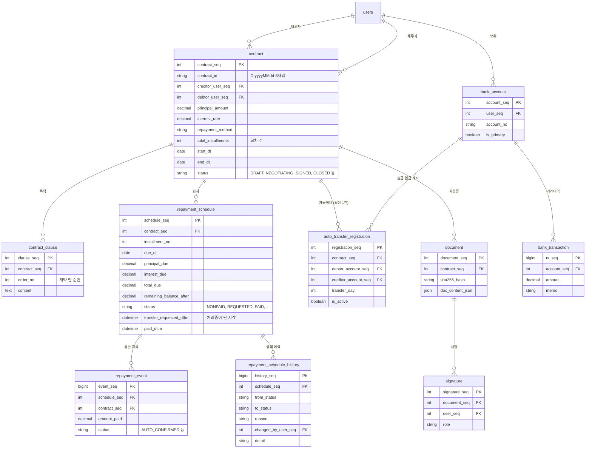

# 데이터 모델

계약과 상환에 관련된 MySQL 테이블입니다. 채팅 메시지는 MongoDB, 리프레시 토큰은 Redis에 있어 여기서는 뺐습니다.

## 설계 포인트

### 회차를 미리 만든다

계약을 만들 때 모든 회차(`repayment_schedule`)를 한꺼번에 생성합니다. 상환일마다 "이번 달에 얼마를 내야 하나"를 계산하지 않고, 이미 만들어진 회차의 상태만 바꿉니다.

- 사용자는 계약 직후부터 전체 상환 일정을 볼 수 있습니다.
- 자동이체, 연체, 수동 상환이 모두 "회차 한 행의 상태"를 기준으로 움직입니다. 동시성 제어도 이 한 행에서 합니다 ([ADR 001](adr/001-conditional-update-claim.md)).
- 대신 행 수가 계약 수 × 회차 수로 늘어나서, 이체 대상 조회에 인덱스가 필요했습니다 ([ADR 006](adr/006-schedule-index.md)).

### 회차 상태

| 상태 | 의미 |
|---|---|
| `NONPAID` | 미납. 자동이체 대상 |
| `REQUESTED` | 이체 처리 중. 결과가 확정될 때까지 다른 이체가 들어오지 못함 |
| `PAID` | 이체로 납부 확정 |
| `OVERDUE` | 기한이 지난 미납 |
| `MANUAL_PAID` | 채권자가 직접 받았다고 처리 |

상태 전이 그림은 [auto-transfer.md](auto-transfer.md)에 있습니다.

### 상태 이력은 지우지 않는다

`repayment_schedule_history`는 추가만 합니다. 회차 상태가 바뀔 때 같은 트랜잭션에서 이전 상태, 다음 상태, 사유, 처리자를 남깁니다. 결과 불명 이체처럼 상태는 그대로인데 기록할 일이 생긴 경우도 남깁니다.

"이 회차가 왜 지금 이 상태인가"를 나중에 확인할 수 있게 하려는 것입니다. 돈과 관련된 상태는 마지막 값만으로는 무슨 일이 있었는지 알 수 없습니다.

### 자동 확정 상환 기록은 회차당 하나

`repayment_event`에는 신고, 반려, 확정 등 여러 기록이 쌓일 수 있어 `schedule_seq` 단독 유니크를 걸 수 없습니다. MySQL에는 부분 인덱스가 없어서, `AUTO_CONFIRMED`일 때만 `schedule_seq`를 담는 생성 컬럼을 만들고 거기에 유니크 인덱스를 겁니다.

조건부 UPDATE가 버그로 뚫려도 같은 회차의 확정이 두 번 남지 않게 하는 마지막 방어선입니다. SQL은 `db/manual/20261013_add_repayment_event_auto_confirmed_unique.sql`에 있고 실제 DB에는 아직 적용하지 않았습니다.

### 금액 컬럼

금액은 모두 `DECIMAL(15, 2)`, 이자율은 `DECIMAL(5, 4)`입니다. 코드에서도 `BigDecimal`로만 계산합니다.

## 그림에서 뺀 테이블

`user_profile`, `social_auth`, `user_consent`, `terms_master`, `user_device_key`, `fcm_token`, `notification_log`, `promise_reminder`, `clause_negotiation`, `early_settlement`, `tax_calculation`

채팅방과 채팅 메시지는 MongoDB 컬렉션입니다.
